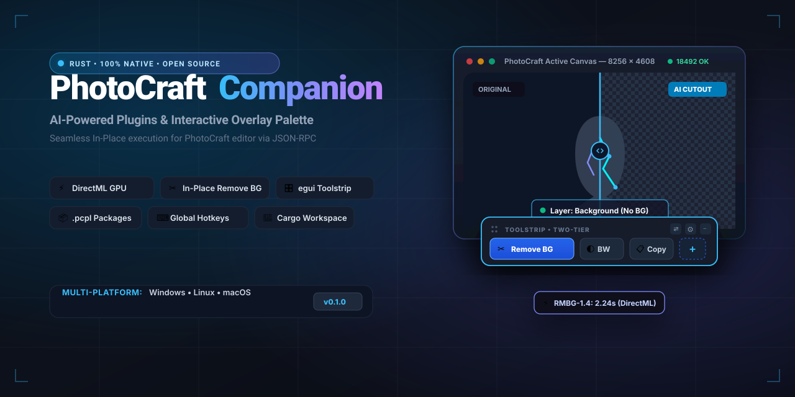

# PhotoCraft Plugins & Companion

<p align="center">
  
</p>

<div align="center">

**[English](README.md)** • [Русский](README.ru.md)

---

[](https://github.com/kobaltgit/photocraft-companion/actions/workflows/ci.yml)
[](https://discord.gg/2gzn4Un4Bw)
[](https://github.com/kobaltgit/photocraft-companion/releases/tag/v1.3.0)
[](LICENSE)
[](https://www.rust-lang.org/)
[](https://github.com/emilk/egui)
[](https://github.com/microsoft/DirectML)
[](GEMINI.md)
[](https://github.com/rust-lang/rustfmt)
[](crates/)

**Extensible plugin ecosystem, local neural tools, and interactive overlay palette for the PhotoCraft graphics editor.**

[Why Companion?](#-why-companion-advantages-over-built-in-photocraft-plugins) • [Features](#-key-features) • [Download & Installers](#-download--installers) • [First-Launch Guide](#-first-launch--onboarding-guide) • [Marketplace](#-community-plugins--marketplace) • [Quick Start](#-quick-start-for-developers) • [Architecture](#-workspace-architecture) • [.pcpl Packages](#-pcpl-package-format) • [Documentation](#-documentation) • [Discord](#-community--discord) • [License](#-license)


</div>

> [!TIP]
> 💬 **Join the PhotoCraft Companion Discord:** Have questions about plugins, ideas for new tools, or need developer assistance? **[Join our Discord Server](https://discord.gg/2gzn4Un4Bw)** to connect directly with the author and community developers!

---

## 💡 About The Project

**PhotoCraft Plugins & Companion** solves the core challenge of seamlessly extending the **PhotoCraft** graphics editor (a modern, open-source Rust-based reimplementation of Photoshop):

- **In-Place Canvas Execution:** Neural background removal, color filters, and custom macro actions execute directly on the active layer of your open canvas over JSON-RPC socket (port 18492) and the system clipboard — no manual saving, reopening, or file dialog gymnastics required.
- **Bypassing Sandbox Limitations:** PhotoCraft natively confines internal plugins inside a strict WebAssembly sandbox without local GPU access or filesystem permissions. The companion provides native, hardware-accelerated DirectML GPU inference and local model storage.

---

## ⚖️ Why Companion? Advantages over Built-in PhotoCraft Plugins

PhotoCraft includes a built-in plugin mechanism based on an internal WebAssembly (Wasm) runtime. While Wasm provides sandboxed safety, it imposes strict technical boundaries that make heavy AI workflows and floating palettes impractical.

Here is how **PhotoCraft Companion** elevates the editing experience:

| Feature | Built-in PhotoCraft Wasm Plugins | PhotoCraft Companion & Ecosystem |
| :--- | :--- | :--- |
| **Local AI & Neural Models** | ❌ **No GPU access** (isolated within Wasm sandbox; cannot run DirectML/Tensor cores) | ✅ **Full DirectML GPU Acceleration** (DirectX 12 / Metal via ONNX Runtime; ~2s inference) |
| **Model Storage & Autonomy** | ❌ Strict memory limits; cannot package or download multi-hundred MB model weights | ✅ **Autonomous Storage:** Models live inside `plugins/<id>/models/` with SHA-256 validation & in-app downloader |
| **No-Code Macro Authoring** | ❌ Requires Rust/C toolchains and manual WebAssembly compilation to `.wasm` | ✅ **Zero-Code JSON:** Just list desired PhotoCraft engine commands in `plugin.json` — ready in 60 seconds |
| **Floating Palette (Toolstrip)** | ❌ Locked inside classic menu bars (`Filter › Plugins`); cannot render floating windows | ✅ **Two-Tier Floating Toolstrip:** Compact `egui` palette hovering over the canvas with orientation toggle & tray minimize |
| **In-App Plugin Marketplace** | ❌ Manual file manipulation into application directories | ✅ **1-Click Marketplace:** Browse online catalog, install, and hot-reload plugins directly from the UI without restarts |
| **In-Place Pixel Pipeline** | ⚠️ Bound to internal Wasm memory buffers | ✅ **Zero-Drift In-Place Execution:** Seamless round-trip active layer processing via JSON-RPC socket and clipboard |

---

## ✨ Key Features

- ✂️ **In-Place AI Tools & Neural Computer Vision (Zero-Core Architecture):**
  - **AI Remove Background:** Bria AI **RMBG-1.4** (~168 MB) high-precision subject cutout with coordinate preservation up to 8K.
  - **AI Generative Fill (LaMa):** Context-aware zero-prompt object removal and texture inpainting with lasso contour synthesis.
  - **AI Super-Resolution (2x):** Real-ESRGAN Compact with seam-blended tiling to upscale arbitrarily large canvases without VRAM overflow.
  - **Resilient AI Runtime:** Hardware-accelerated **DirectML (DirectX 12 GPU)** with automatic transparent fallback to CPU on unsupported operators.
  - **Ultra-Fast Cached GPU Tiling:** Single-session GPU pipeline caching reducing large canvas inference times up to 25x.
  - **Zero-Core Standard:** Zero plugin-specific logic hardcoded into the companion core; every workflow is strictly declarative via `plugin.json`.

- 📐 **Photoshop-Style Tool Variations (Sub-Actions & Flyouts):**
  - Tools can declare multiple sub-actions (e.g. Cutout to new layer vs Non-destructive Layer Mask).
  - Buttons render a subtle vector corner chevron; long-pressing (>350ms) or clicking the chevron opens a dedicated floating flyout window (`egui::ViewportBuilder`) with sub-tools.
  - Active sub-action selection is remembered in persistent user settings.

- ⚡ **Declarative Workflow Engine & Context Variables:**
  - Multi-step pipelines with variable interpolation (`$source_layer`, `$result_layer`, `$active_layer`, `$doc_width`, `$doc_height`, `$has_selection`, `$fg_color`, `$bg_color`, and string interpolation `{{...}}`).
  - Conditional branching (`when: "$has_selection == true"`), layer variable saving (`save_as`), error tolerance (`ignore_errors`), and sandboxed Rhai scripting.

- 🔄 **Bidirectional Session Color Sync & Echo Guard:**
  - Two-way real-time color syncing between PhotoCraft tools (Eyedropper `I`, default `D`, swap `X`) and interactive plugins.
  - Zero-waste polling (180ms only when windows are open) with smart echo prevention (`echo_guard`).

- 🎛️ **Interactive Multi-Viewport UI:**
  - Dedicated floating windows with customizable reactive widgets (sliders, color swatches, hue wheel, contrast diagnostics, dropdowns, toggles) running on Rhai scripting.

- 🏪 **In-App Community Plugin Marketplace:**
  - Integrated 4th tab inside the Plugin Manager to discover and install community plugins directly from GitHub Releases.
  - Instant 1-click installation of lightweight `.pcpl` archives (< 1 KB) with reactive toolbar hot-reloading (no restart required).
  - Background SVG icon rendering with dark and light theme adaptation.
  - Local offline registry caching for uninterrupted operation.

- 🎛️ **Floating Two-Tier Toolstrip (`egui` / `eframe`):**
  - Ultra-compact floating palette matching PhotoCraft's native UI aesthetics with pure vector SVG icons.
  - Orientation toggle: seamlessly switch between Horizontal (78 px height) and Vertical (50 px width) modes with zero button clipping.
  - Non-intrusive floating palette behavior: excluded from OS taskbar (`.with_taskbar(false)`), persistent drag & drop screen coordinates.
  - Floating mini-HUD status badge with live timer and busy lock.

- ⚙️ **Comprehensive Plugin Manager:**
  - Tabbed interface: `[ General ]`, `[ Plugins ]`, `[ Store ]`, `[ About ]`.
  - Live connection indicator: 3-state real-time socket status (`● Connected` / `● Auth Required` / `○ Offline`) with token browse dialog (`rfd`).
  - Native themes: instant synchronization between Dark and pure Light modes.
  - In-App self-updater: checks for new GitHub releases, compares SemVer versions, and downloads platform installers with 1 click.

- 📦 **100% Autonomous `.pcpl` Package Ecosystem:**
  - Plugin neural weights are fully self-contained inside each plugin directory (`plugins/<id>/models/`).
  - Model integrity verification, progress bars with live transfer speed (MB/s), and automatic missing weights downloader directly in the UI.

- 🌐 **Internationalization (15 UI Languages, 22 Host Parameter Languages) & Smart Parameter Retry:**
  - **15 Verified UI Languages (`Language::UI_SUPPORTED`):** Complete Companion interface localization for Latin and Cyrillic script languages with guaranteed font rendering in egui, strictly avoiding unsupported CJK ideographs to prevent Unicode tofu squares (`□`).
  - **Safe Font Fallback (`safe_ui_language`):** When PhotoCraft runs in East Asian or complex script environments (Japanese, Chinese, Korean, Hindi), Companion UI automatically and safely renders in English.
  - **Smart Parameter Retry:** Automatic translation of internal PhotoCraft parameters (such as 28 layer blend modes) across all 22 official host languages.
  - **Native System Locale Detection:** Native BCP 47 dialect normalization (`sys-locale`) automatically matching PhotoCraft's interface language out of the box (`ru-KZ` -> `ru`, `cs-CZ` -> `cs`).
  - **Multilingual Plugin Manifests:** Full support for `locales` dictionary in `plugin.json` and sub-actions.

- ⏳ **Modernized Standby / Offline UX:**
  - Sleek waiting window when PhotoCraft is not running, featuring background polling on port 18492.
  - Free drag-and-drop movement across multi-monitor setups with coordinate persistence.
  - Vector pushpin for Always-on-Top pinning and minimize-to-tray capability without interrupting socket monitoring.

- 🔔 **Instant Reactive System Tray (0 ms):**
  - System tray icon across Windows, Linux, and macOS with zero-latency dispatching and native Win32 dark context menu support.

---

## 📦 Download & Installers

Ready-to-use binaries are built for every platform as both full **installers** and standalone **portable archives**:

| Platform                          | Installer (Setup)                             | Portable Archive                                           | Notes                                                              |
| :-------------------------------- | :-------------------------------------------- | :--------------------------------------------------------- | :----------------------------------------------------------------- |
| **Windows (x64)**                 | `PhotoCraft-Companion-Setup-Windows-x64.exe`  | `PhotoCraft-Companion-v1.3.0-windows-x64-portable.zip`     | Inno Setup installer with tray autostart / No-registry portable zip |
| **macOS (Apple Silicon & Intel)** | `PhotoCraft-Companion-Setup-macOS.dmg`        | `photocraft-companion-v1.3.0-macos-portable.tar.gz`        | Drag-and-drop DMG image for `/Applications` / Standalone `.app`    |
| **Linux (x86_64)**                | `photocraft-companion_1.3.0_amd64.deb`        | `photocraft-companion-v1.3.0-linux-x64-portable.tar.gz`    | Debian package with desktop icon & app menu / Standalone tar.gz    |

> [!TIP]
> All release binaries are published on the **[GitHub Releases](https://github.com/kobaltgit/photocraft-companion/releases)** page.

> [!NOTE]
> **macOS Gatekeeper Note:** If macOS displays a warning saying *"The application is damaged and can't be opened"* or blocks unsigned open-source applications, open Terminal and remove the quarantine attribute:
> ```bash
> xattr -cr "/Applications/PhotoCraft Companion.app"
> ```
> Alternatively, go to **System Settings › Privacy & Security** and select **Open Anyway**.

---

## 🚦 First-Launch & Onboarding Guide

PhotoCraft Companion communicates with PhotoCraft through a local control socket (port 18492) using a security token (`control.token`). Starting with **v1.0.7**, launching and pairing are completely automated in one click!

### Method 1: One-Click Launch via Companion (Recommended)
1. **Start PhotoCraft Companion**:
   - If PhotoCraft is not running yet, Companion displays a sleek standby window: *"Waiting for PhotoCraft..."*.
2. **Launch in 1 Click**:
   - Click the **`[ > Launch PhotoCraft ]`** button directly in the waiting window (or in **Settings › General**).
   - Companion automatically discovers `photocraft.exe` across standard locations (or you can point to it once via `[ Browse... ]`), generates a cryptographically secure 64-character `control.token`, launches PhotoCraft with `--control 18492 --control-token-file`, and establishes the connection.
   - The configured executable path is safely persisted and mirrored in portable mode.
3. **Start Creating**:
   - Once PhotoCraft is running, the waiting window seamlessly transforms into the floating toolbar above your canvas.

### Method 2: Manual PhotoCraft Launch
If you prefer starting PhotoCraft from custom shortcuts or command line:
1. Launch PhotoCraft with the control socket arguments:
   ```powershell
   photocraft.exe --control 18492 --control-token-file "PhotoCraftData/control.token"
   ```
2. Start `photocraft-companion.exe`. It automatically detects the running process, reads `control.token`, and turns the connection indicator to **● Connected**.

---

### Building Packages Locally

- **Windows:**
  ```powershell
  .\scripts\package_release.ps1
  ```
  *(Creates a portable `.zip` in `dist/` and builds the Inno Setup installer if ISCC is installed).*

- **Linux / macOS:**
  ```bash
  chmod +x ./scripts/package_release.sh
  ./scripts/package_release.sh
  ```

---

## 🚀 Quick Start (for Developers)

### Prerequisites

- **OS:** Windows 10 / 11 (x64), Linux (X11 / Wayland), or macOS
- **Rust:** Toolchain 1.80+ (2021 edition)
- **GPU (optional):** Any DirectX 12 capable GPU (NVIDIA, AMD, Intel) for DirectML acceleration.

### 1. Clone Repository

```bash
git clone https://github.com/kobaltgit/photocraft-companion.git
cd photocraft-companion
```

### 2. Fetch AI Model Weights

Model weights are excluded from Git (`.gitignore`) to keep the repository lightweight. Run the download script to fetch RMBG-1.4:

```powershell
.\scripts\fetch_models.ps1
```

*(Alternatively, click `[ ⬇ Download Model ]` inside the Plugin Manager UI on first run).*

### 3. Build & Run

```bash
# Launch the companion application
cargo run --package companion_app
```

### 4. Quality Gates & Testing

To maintain uncompromising reliability and ensure the Zero-Core architecture remains free of hacks, execute our automated test barriers:

> [!NOTE]
> **Resource Guard Rule:** Always execute `cargo` commands with the `-j 1` single-thread flag to prevent CPU and RAM starvation on developer machines.

```bash
# 1. Code Formatting (Zero-tolerance style check)
cargo fmt --all -- --check

# 2. Complete Workspace Test Suite (152 unit & integration tests)
cargo test --workspace -j 1

# 3. Core Architecture Integrity Linter (Strict Zero-Core & anti-sniffing barrier)
cargo test -p ai_engine --test architecture_integrity_test -j 1

# 4. Dev Regulations Linter (5-file SemVer sync, crate isolation, chronicle parity, model isolation)
cargo test -p ai_engine --test dev_regulations_lint_test -j 1

# 5. UI Linters (Strict i18n localization & Vector-First UI / anti-tofu barrier)
cargo test -p overlay_ui --test i18n_lint_test -j 1
cargo test -p overlay_ui --test vector_first_lint_test -j 1

# 6. Ecosystem Plugin & Registry Validator (Validates manifests, vector SVG icons & model links)
cargo run -p plugin_validator -j 1 -- --validate plugins
```

---

## 🏗 Workspace Architecture

The project is structured as a modular Cargo Workspace with strict separation of concerns:

```text
photocraft-plugins/
├── Cargo.toml                      # Root Rust Workspace manifest
├── crates/                         # Independent crates
│   ├── core_contracts/            # Plugin traits, DTOs, Config, i18n, .pcpl installer
│   ├── photocraft_bridge/         # Async PhotoCraft socket client (JSON-RPC 18492)
│   ├── ai_engine/                 # DirectML GPU ONNX runtime inference (RMBG, Real-ESRGAN, LaMa)
│   ├── overlay_ui/                # Floating Toolstrip, In-App Store, Plugin Manager (egui 0.36)
│   ├── plugin_validator/          # Ecosystem CLI: validation, packaging, marketplace generator
│   └── companion_app/             # Main binary (system tray, lifecycle, DI container, workflow engine)
├── plugins/                       # Installed plugin directory
│   ├── black_and_white/          # Declarative No-Code macro plugin
│   ├── chromasense/              # Interactive UI A11y color panel (Rhai, WCAG 2.1, CVD simulation)
│   ├── depth_map/                 # Autonomous AI 3D depth estimation plugin (Depth Anything V2)
│   ├── inpaint/                   # Autonomous AI generative fill plugin (LaMa)
│   ├── remove_bg/                 # Autonomous AI background removal plugin (RMBG-1.4, Sub-Actions)
│   ├── upscale/                   # Autonomous AI 2x super-resolution plugin (Real-ESRGAN)
│   └── vectorize/                 # Autonomous Smart Vectorizer / SVG Trace algorithm plugin
├── scripts/
│   ├── fetch_models.ps1           # PowerShell model downloader
│   ├── package_release.ps1        # Inno Setup & Windows packaging script
│   └── package_release.sh         # Linux DEB & macOS DMG packaging script
└── docs/                          # Engineering specifications & dev chronicles
```

---

## 📦 `.pcpl` Package Format

Any plugin can be distributed as a portable `.pcpl` archive (ZIP format):

```text
my_plugin.pcpl
├── plugin.json              # Declarative manifest (metadata, commands, hotkeys)
├── icon.svg                 # Vector palette icon
└── models/                  # (Optional) Local ONNX neural weights
    └── rmbg-1.4.onnx
```

Install any `.pcpl` file with a single click via `[ + Install Plugin (.pcpl) ]` inside the Plugin Manager.

---

## 🏪 Community Plugins & Marketplace

Download community plugins as ready-to-use `.pcpl` packages and drop them into your Companion or install them in 1-click via the **Plugin Manager**:

<!-- PLUGINS_CATALOG_START -->

| Icon | Plugin & Description | Type | Version | Author | Package (.pcpl) |
| :---: | :--- | :---: | :---: | :--- | :---: |
|  | **B&W Film Pop (No-Code)**<br>_Duplicates active layer, converts to grayscale with auto-contrast adjustment._ | `⚡ Macro` | `1.0.0` | kobaltGIT | [📥 Download .pcpl](https://github.com/kobaltgit/photocraft-companion/releases/download/plugins/black_and_white.pcpl) |
|  | **ChromaSense**<br>_Accessibility Color Assistant for artists with color vision deficiencies_ | `🎨 UI Panel` | `1.0.0` | kobaltGIT | [📥 Download .pcpl](https://github.com/kobaltgit/photocraft-companion/releases/download/plugins/chromasense.pcpl) |
|  | **AI Depth Map (Depth Anything V2)**<br>_State-of-the-art monocular 3D depth estimation for Lens Blur, bokeh and atmospheric lighting via Depth Anything V2._ | `🤖 AI (ONNX)` | `1.0.0` | kobaltGIT | [📥 Download .pcpl](https://github.com/kobaltgit/photocraft-companion/releases/download/plugins/depth_map.pcpl) |
|  | **Pro Dodge & Burn (50% Gray)**<br>_Creates a non-destructive 50% Gray Soft Light layer with a B&W visual aid layer for professional Dodge & Burn contouring._ | `⚡ Macro` | `1.0.0` | kobaltGIT | [📥 Download .pcpl](https://github.com/kobaltgit/photocraft-companion/releases/download/plugins/dodge_and_burn.pcpl) |
|  | **Frequency Separation (Retouch)**<br>_Splits portrait into high-frequency texture and low-frequency color layers for professional beauty retouching._ | `⚡ Macro` | `1.0.0` | kobaltGIT | [📥 Download .pcpl](https://github.com/kobaltgit/photocraft-companion/releases/download/plugins/frequency_separation.pcpl) |
|  | **AI Generative Fill (LaMa)**<br>_Zero-prompt neural generative fill and object eraser for PhotoCraft using LaMa model via DirectML GPU._ | `🤖 AI (ONNX)` | `1.0.0` | kobaltGIT | [📥 Download .pcpl](https://github.com/kobaltgit/photocraft-companion/releases/download/plugins/inpaint.pcpl) |
|  | **PopCraft 3D**<br>_Interactive 2.5D typography and graphic pop-out tool with vector angle pad, extrude depth, bevel contour and drop shadow._ | `🎨 UI Panel` | `1.0.0` | kobaltGIT | [📥 Download .pcpl](https://github.com/kobaltgit/photocraft-companion/releases/download/plugins/popcraft_3d.pcpl) |
|  | **AI Remove Background (RMBG-1.4)**<br>_High-fidelity neural background removal for PhotoCraft using Bria AI RMBG-1.4 model via local ONNX Runtime._ | `🤖 AI (ONNX)` | `1.1.1` | kobaltGIT | [📥 Download .pcpl](https://github.com/kobaltgit/photocraft-companion/releases/download/plugins/remove_bg.pcpl) |
|  | **Cinematic Teal & Orange**<br>_Applies a Hollywood cinematic color grade with 3D LUT, film contrast S-curve, and skin vibrance protection._ | `⚡ Macro` | `1.0.0` | kobaltGIT | [📥 Download .pcpl](https://github.com/kobaltgit/photocraft-companion/releases/download/plugins/teal_orange.pcpl) |
|  | **AI Super-Resolution (2x)**<br>_2x neural super-resolution upscale for PhotoCraft active layer via local ONNX Runtime & DirectML GPU._ | `🤖 AI (ONNX)` | `1.0.0` | kobaltGIT | [📥 Download .pcpl](https://github.com/kobaltgit/photocraft-companion/releases/download/plugins/upscale.pcpl) |
|  | **Smart Vectorizer / SVG Trace**<br>_High-fidelity vectorization and SVG tracing of raster layers with Bezier curve fitting._ | `📐 Algorithm` | `1.0.0` | kobaltGIT | [📥 Download .pcpl](https://github.com/kobaltgit/photocraft-companion/releases/download/plugins/vectorize.pcpl) |

<!-- PLUGINS_CATALOG_END -->

> [!TIP]
> **Want to publish your own plugin?** Check out the [Plugin Development Guide](docs/PLUGIN_DEVELOPMENT_GUIDE.en.md), create your plugin inside `plugins/<id>/`, and submit a Pull Request! Our automated CI validates your manifest, icon, and neural models before publishing.

---

## 📚 Documentation

Detailed specifications and development history can be found in [`docs/`](docs/):

- 📘 [`GEMINI.md`](GEMINI.md) — Master architectural manifest.
- 📋 [`docs/AGENTS_MASTER_GUIDE.md`](docs/AGENTS_MASTER_GUIDE.md) — Master development regulations and AI agent guidelines.
- 🎯 [`docs/PLAN.md`](docs/PLAN.md) — Implementation blueprint for floating UI and autonomous plugins.
- 🗺️ [`docs/ROADMAP.md`](docs/ROADMAP.md) — Project roadmap and milestones.
- ✅ [`docs/CHECKLIST.md`](docs/CHECKLIST.md) — Interactive phase-by-phase checklist.
- 🐛 [`docs/BUGS_AND_ISSUES.md`](docs/BUGS_AND_ISSUES.md) — Defect tracking log (BUG-001 through BUG-075).
- 📜 [`docs/CHRONICLE.md`](docs/CHRONICLE.md) / [`docs/CHRONICLE.en.md`](docs/CHRONICLE.en.md) — Chronological developer devlog in Russian and English.
- 🛠️ [`docs/PLUGIN_DEVELOPMENT_GUIDE.en.md`](docs/PLUGIN_DEVELOPMENT_GUIDE.en.md) / [`RU`](docs/PLUGIN_DEVELOPMENT_GUIDE.md) — Plugin Developer Guide (No-Code macros, AI inference, workflows).
- 📖 [`docs/PHOTOCRAFT_COMMANDS_REFERENCE.en.md`](docs/PHOTOCRAFT_COMMANDS_REFERENCE.en.md) / [`RU`](docs/PHOTOCRAFT_COMMANDS_REFERENCE.md) — Complete Catalog of all **851** PhotoCraft Engine Commands.
- 📐 [`docs/UNIVERSAL_PLUGIN_CORE_SPECIFICATION.md`](docs/UNIVERSAL_PLUGIN_CORE_SPECIFICATION.md) — Universal Core specification (Rhai, CLI runner, C-ABI dynamic libs).
- 🚀 [`docs/FIRST_RUN_GUIDE.md`](docs/FIRST_RUN_GUIDE.md) — First-Run & Installation Guide (Windows, macOS, Linux).
- 🤝 [`CONTRIBUTING.md`](CONTRIBUTING.md) — Contribution guidelines, golden rules, and PR checklist.

---

## 💬 Community & Discord

Have questions, suggestions, or want to share your custom plugins with fellow digital artists?
Join the official **PhotoCraft Companion Discord Server**:

<div align="center">

[](https://discord.gg/2gzn4Un4Bw)

**👉 [https://discord.gg/2gzn4Un4Bw](https://discord.gg/2gzn4Un4Bw)**

</div>

---

## ⭐ Star History

<p align="center">
  
</p>

---

## 👤 Author

**kobaltGIT** ([GitHub](https://github.com/kobaltgit))

---

## 📄 License

This project is licensed under the [MIT License](LICENSE).