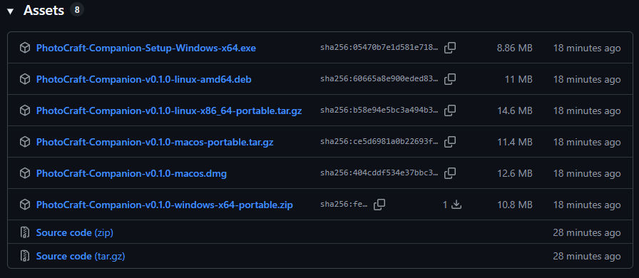

# PhotoCraft Plugins & Companion

<p align="center">
  
</p>

<div align="center">

[English](README.md) • **[Русский](README.ru.md)**

---

[](https://github.com/kobaltgit/photocraft-companion/actions/workflows/ci.yml)
[](https://github.com/kobaltgit/photocraft-companion/releases/tag/v0.1.0)
[](LICENSE)
[](https://www.rust-lang.org/)
[](https://github.com/emilk/egui)
[](https://github.com/microsoft/DirectML)
[](crates/)

**Экосистема плагинов, локальных нейросетей и оверлей-панелей для графического редактора PhotoCraft.**

[Почему Companion?](#-почему-companion-преимущества-перед-встроенной-системой-плагинов-photocraft) • [Возможности](#-основные-возможности) • [Установка и дистрибутивы](#-установка-и-дистрибутивы-installers--portable) • [Быстрый старт](#-быстрый-старт-для-разработчиков) • [Архитектура](#-архитектура-монорепозитория) • [Пакеты .pcpl](#-пакетный-формат-pcpl) • [Документация](#-документация-проекта) • [Лицензия](#-лицензия)


</div>

---

## 💡 О проекте

**PhotoCraft Plugins & Companion** решает задачу расширения графического редактора **PhotoCraft** (open-source reimplementation of Photoshop на Rust):

- **Бесшовное исполнение (In-Place Execution):** все операции (вырезание фона нейросетью, фильтры, макросы) выполняются прямо на активном слое в открытом холсте редактора через протокол JSON-RPC (порт 18492) и системный буфер обмена без ручного сохранения/открытия файлов.
- **В обход Wasm-песочницы:** редактор PhotoCraft запускает плагины в изолированной песочнице без прямого доступа к локальному GPU и диску. Компаньон предоставляет нативный доступ к DirectML и ONNX Runtime.

---

## ⚖️ Почему Companion? Преимущества перед встроенной системой плагинов PhotoCraft

В редактор PhotoCraft заложен собственный внутренний механизм расширений на базе WebAssembly (Wasm). Несмотря на безопасность песочницы, строгая изоляция Wasm делает невозможными тяжелые нейросетевые вычисления и современные плавающие интерфейсы.

**PhotoCraft Companion** выводит возможности редактора на принципиально иной уровень:

| Критерий | Встроенные Wasm-плагины PhotoCraft | PhotoCraft Companion & Экосистема |
| :--- | :--- | :--- |
| **Локальный ИИ и нейросети** | ❌ **Нет доступа к GPU** (изолированы внутри Wasm; невозможно задействовать тензорные ядра DirectML / Metal) | ✅ **Полное DirectML GPU ускорение** (DirectX 12 / Metal через ONNX Runtime; инференс за ~2 секунды) |
| **Хранение моделей и автономность** | ❌ Лимит виртуальной памяти песочницы; невозможно упаковать веса в сотни мегабайт | ✅ **100% автономия:** Модели лежат в `plugins/<id>/models/`, автопроверка SHA-256 и загрузка в 1 клик |
| **Создание No-Code макросов** | ❌ Требуется компилятор Rust/C и сборка в `.wasm` через wasm-pack | ✅ **Zero-Code JSON:** Достаточно перечислить нужные команды PhotoCraft в `plugin.json` — готово за 1 минуту |
| **Плавающая панель (Toolstrip)** | ❌ Заперты в статичном верхнем меню (`Фильтры › Плагины`); нет своего окна | ✅ **Двухъярусный Toolstrip:** Компактная палитра на `egui` поверх холста с переключением ориентации и треем |
| **Горячие клавиши** | ❌ Срабатывают только при активном фокусе окна PhotoCraft | ✅ **Глобальные хоткеи ОС:** Демон `global-hotkey` слушает системные нажатия во всей ОС даже при свернутом окне |
| **Установка расширений** | ❌ Ручное копирование файлов по системным каталогам | ✅ **Пакеты `.pcpl` в 1 клик:** Установка и горячая перезагрузка через Менеджер плагинов без перезапуска редактора |
| **In-Place пиксельный конвейер** | ⚠️ Привязаны к внутренним буферам Wasm ABI | ✅ **Субпиксельный In-Place конвейер:** Прямой высокоскоростной обмен пикселями через JSON-RPC и память буфера |

---


## ✨ Основные возможности

- ✂️ **Локальное нейросетевое удаление фона (AI In-Place Remove BG):**
  - Встроенная модель Bria AI **RMBG-1.4** (~168 МБ).
  - Аппаратное ускорение **DirectML (DirectX 12 GPU)** для видеокарт NVIDIA, AMD и Intel с безопасным откатом на CPU.
  - Сохранение геометрии на холстах любого разрешения (проверено вплоть до 8K: 8256×4608).
  - Интеллектуальное именование: автоматическое добавление мультиязычного суффикса `(No BG)` / `(Без фона)` без дублирования.

- 🎛️ **Плавающая панель инструментов (Two-Tier Floating Toolstrip):**
  - Компактная двухъярусная палитра на `egui` / `eframe` с родной эстетикой PhotoCraft.
  - Переключение между горизонтальной (высота 78 px) и вертикальной (ширина 50 px) ориентацией без обрезания кнопок при любом числе плагинов $N$.
  - Парящий режим: панель не засоряет панель задач Windows (`.with_taskbar(false)`).
  - Всплывающие независимые тултипы поверх рабочего стола.

- ⚙️ **Менеджер плагинов (Plugin Manager):**
  - Верхние горизонтальные вкладки: `[ General ]`, `[ Plugins ]`, `[ Hotkeys ]`, `[ About ]`.
  - Индикатор связи: статус сокета PhotoCraft (`● Connected` / `○ Offline`).
  - Темы оформления: синхронизация тёмной и чистой светлой тем.
  - Интерактивный рекордер горячих клавиш: захват сложных комбинаций (`Ctrl+Shift+...`) с защитой от залипания модификаторов.

- 📦 **100% автономность и формат пакетов `.pcpl`:**
  - Все веса нейросетей хранятся локально в папке плагина (`plugins/<id>/models/`).
  - Установка расширений в один клик из файлов `.pcpl` (PhotoCraft Plugin Package) через стандартный диалог проводника.
  - Автопроверка целостности моделей и скачивание отсутствующих весов прямо из GUI.

- ⏳ **Режим ожидания редактора (Offline Mode):**
  - Компаньон не завершает работу с ошибкой, если PhotoCraft закрыт, а выводит графитовое окно ожидания.
  - Фоновый опрос сокета каждые 1.5 секунды: как только редактор запускается, тулбар бесшовно появляется на холсте.

- 🔔 **Реактивный системный трей (0 ms):**
  - Фоновое прослушивание хоткеев и управление окнами через иконку в системном трее (Windows, Linux, macOS).
  - Мгновенный отклик меню без задержек и нативная тёмная тема контекстного меню Windows.

---

## 📦 Установка и дистрибутивы (Installers & Portable)

Для удобства пользователей проект распространяется в двух форматах для каждой платформы: **готовый установщик (Setup)** и **автономная портабельная версия (Portable)**:

<p align="center">
  
</p>

| Платформа                         | Установщик (Setup / Installer)                | Портабельная версия (Portable)                             | Описание                                                                           |

| :-------------------------------- | :-------------------------------------------- | :--------------------------------------------------------- | :--------------------------------------------------------------------------------- |
| **Windows (x64)**                 | `PhotoCraft-Companion-Setup-Windows-x64.exe`  | `PhotoCraft-Companion-v0.1.0-windows-x64-portable.zip`     | Инсталлятор с автозапуском в трее и ярлыками / Portable-архив без записей в реестр |
| **macOS (Apple Silicon & Intel)** | `PhotoCraft-Companion-macos.dmg`              | `PhotoCraft-Companion-v0.1.0-macos-portable.tar.gz`        | DMG-образ с перетаскиванием в `/Applications` / Автономный архив `.tar.gz`         |
| **Linux (x86_64)**                | `PhotoCraft-Companion-v0.1.0-linux-amd64.deb` | `PhotoCraft-Companion-v0.1.0-linux-x86_64-portable.tar.gz` | DEB-пакет с интеграцией меню приложений и `.desktop` / Автономный tar.gz архив     |

> [!TIP]
> Все готовые сборки автоматически публикуются на странице **[GitHub Releases](https://github.com/kobaltgit/photocraft-companion/releases)** при каждом релизе.

### Локальная сборка установщиков и дистрибутивов

- **Windows:**
  ```powershell
  .\scripts\package_release.ps1
  ```
  _(Создаёт портабельный архив `.zip` в каталоге `dist/` и компилирует Inno Setup инсталлятор при наличии ISCC)._

- **Linux / macOS:**
  ```bash
  chmod +x ./scripts/package_release.sh
  ./scripts/package_release.sh
  ```

---

## 🚀 Быстрый старт (для разработчиков)

### Требования

- **ОС:** Windows 10 / 11 (x64), Linux или macOS
- **Rust:** Toolchain 1.80+ (версия 2021)
- **GPU (опционально):** Любая видеокарта с поддержкой DirectX 12 (NVIDIA RTX / AMD Radeon / Intel Arc) для DirectML-ускорения.

### 1. Клонирование репозитория

```bash
git clone https://github.com/kobaltgit/photocraft-companion.git
cd photocraft-companion
```

### 2. Загрузка весов нейросетей (для разработчиков)

Модели нейросетей исключены из репозитория (`.gitignore`) для сохранения чистоты и легковесности Git. Для загрузки весов RMBG-1.4 выполните скрипт:

```powershell
.\scripts\fetch_models.ps1
```

_(Либо веса можно скачать в один клик через кнопку `[ ⬇ Скачать модель ]` в Менеджере плагинов при первом запуске)._

### 3. Сборка и запуск

```bash
# Запуск тестов воркспейса (62 теста) с безопасным ограничением потоков
cargo test --workspace -j 1

# Запуск приложения компаньона
cargo run --package companion_app
```

---

## 🏗 Архитектура монорепозитория

Проект организован как модульный Cargo Workspace с чистым разделением обязанностей:

```text
photocraft-plugins/
├── Cargo.toml                      # Корневой манифест Rust Cargo Workspace
├── crates/                         # Независимые пакеты
│   ├── core_contracts/            # Трейты Plugin, DTO, Config, i18n, пакетный установщик .pcpl
│   ├── photocraft_bridge/         # Асинхронный клиент сокета PhotoCraft (JSON-RPC 18492)
│   ├── ai_engine/                 # DirectML GPU инференс (ort, ONNX Runtime, RMBG-1.4)
│   ├── overlay_ui/                # Плавающий тулбар, Менеджер плагинов и оверлеи (egui 0.36)
│   ├── hotkey_service/            # Глобальные горячие клавиши ОС (global-hotkey)
│   └── companion_app/             # Главный бинарник (системный трей, DI, жизненный цикл)
├── plugins/                       # Каталог установленных плагинов
│   ├── remove_bg/                 # Автономный плагин нейросетевого удаления фона
│   └── black_and_white/          # Декларативный No-Code макрос
├── scripts/
│   ├── fetch_models.ps1           # Скрипт подгрузки нейросетевых моделей (PowerShell)
│   ├── package_release.ps1        # Скрипт сборки инсталлятора Windows (Inno Setup)
│   └── package_release.sh         # Скрипт сборки DEB, DMG и tar.gz (Linux & macOS)
└── docs/                          # Центр документации и спецификаций
```

---

## 📦 Пакетный формат `.pcpl`

Любой плагин может быть упакован в переносимый ZIP-контейнер `.pcpl`:

```text
my_plugin.pcpl
├── plugin.json              # Декларативный манифест
├── icon.svg                 # Векторная иконка для панели
└── models/                  # (опционально) Локальные веса ONNX
    └── rmbg-1.4.onnx
```

Установка выполняется в один клик через кнопку `[ + Установить плагин (.pcpl) ]` в окне Менеджера плагинов.

---

## 🏪 Витрина и каталог плагинов (Plugin Marketplace)

Готовые пакеты `.pcpl` можно скачать в 1 клик и сразу установить через **Менеджер плагинов** Компаньона:

<!-- PLUGINS_CATALOG_START -->

| Иконка | Название и плагин | Тип | Версия | Автор | Пакет (.pcpl) |
| :---: | :--- | :---: | :---: | :--- | :---: |
|  | **B&W Film Pop (No-Code)**<br>_Duplicates active layer, converts to grayscale with auto-contrast adjustment._ | `⚡ Macro` | `1.0.0` | kobaltGIT | [📥 Скачать .pcpl](https://github.com/kobaltgit/photocraft-companion/releases/download/plugins/black_and_white.pcpl) |
|  | **AI Generative Fill (LaMa)**<br>_Zero-prompt neural generative fill and object eraser for PhotoCraft using LaMa model via DirectML GPU._ | `🤖 AI (ONNX)` | `1.0.0` | kobaltGIT | [📥 Скачать .pcpl](https://github.com/kobaltgit/photocraft-companion/releases/download/plugins/inpaint.pcpl) |
|  | **AI Remove Background (RMBG-1.4)**<br>_High-fidelity neural background removal for PhotoCraft using Bria AI RMBG-1.4 model via local ONNX Runtime._ | `🤖 AI (ONNX)` | `1.0.0` | kobaltGIT | [📥 Скачать .pcpl](https://github.com/kobaltgit/photocraft-companion/releases/download/plugins/remove_bg.pcpl) |
|  | **AI Super-Resolution (2x)**<br>_2x neural super-resolution upscale for PhotoCraft active layer via local ONNX Runtime & DirectML GPU._ | `🤖 AI (ONNX)` | `1.0.0` | kobaltGIT | [📥 Скачать .pcpl](https://github.com/kobaltgit/photocraft-companion/releases/download/plugins/upscale.pcpl) |

<!-- PLUGINS_CATALOG_END -->

> [!TIP]
> **Хотите опубликовать свой плагин?** Изучите [Руководство разработчика плагинов](docs/PLUGIN_DEVELOPMENT_GUIDE.md), создайте директорию в `plugins/<id>/` и отправьте Pull Request! Наш автоматический CI проверит манифест, векторную иконку и веса моделей перед публикацией.

---

## 📚 Документация проекта

Подробные инженерные спецификации и журнал разработки находятся в папке [`docs/`](docs/):

- 📘 [`GEMINI.md`](GEMINI.md) — Главный архитектурный манифест проекта.
- 🎯 [`docs/PLAN.md`](docs/PLAN.md) — План реализации плавающей панели и автономных плагинов.
- 🗺️ [`docs/ROADMAP.md`](docs/ROADMAP.md) — Дорожная карта этапов разработки.
- ✅ [`docs/CHECKLIST.md`](docs/CHECKLIST.md) — Интерактивный чек-лист статуса всех фаз.
- 🐛 [`docs/BUGS_AND_ISSUES.md`](docs/BUGS_AND_ISSUES.md) — Журнал решенных дефектов (BUG-001 – BUG-029).
- 📜 [`docs/CHRONICLE.md`](docs/CHRONICLE.md) / [`docs/CHRONICLE.en.md`](docs/CHRONICLE.en.md) — Авторская летопись разработки.
- 🛠️ [`docs/PLUGIN_DEVELOPMENT_GUIDE.md`](docs/PLUGIN_DEVELOPMENT_GUIDE.md) / [`EN`](docs/PLUGIN_DEVELOPMENT_GUIDE.en.md) — Руководство разработчика плагинов (No-Code макросы, нейросети, создание расширений).
- 📖 [`docs/PHOTOCRAFT_COMMANDS_REFERENCE.md`](docs/PHOTOCRAFT_COMMANDS_REFERENCE.md) / [`EN`](docs/PHOTOCRAFT_COMMANDS_REFERENCE.en.md) — Полный каталог всех **851** команд ядра PhotoCraft.
- 📐 [`docs/UNIVERSAL_PLUGIN_CORE_SPECIFICATION.md`](docs/UNIVERSAL_PLUGIN_CORE_SPECIFICATION.md) — Спецификация универсального ядра (Rhai, CLI, C-ABI DynLib).


---

## 👤 Автор

**kobaltGIT** ([GitHub](https://github.com/kobaltgit))

---

## 📄 Лицензия

Проект распространяется под открытой лицензией [MIT License](LICENSE).
