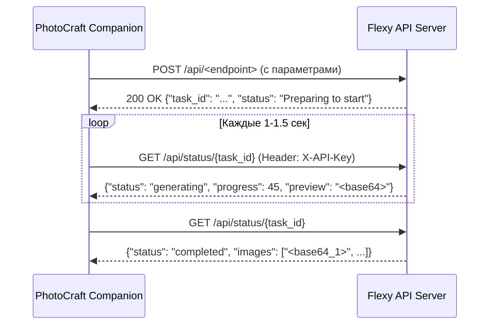

# Официальная спецификация Flexy AI API (Flexy API Reference)

> **Источник данных:** Официальная документация платформы [Flexy AI](https://flexy-ai.com/api-docs) (автор — XpucT).  
> **Назначение:** Технический справочник для разработчиков плагинов и агентов PhotoCraft Companion.

---

## 1. Общие сведения и сетевой транспорт

* **Базовый URL API:** `https://flexy-ai.com/api`
* **Авторизация:** Заголовок `X-API-Key: flexy-********************************`
* **Формат данных:** `application/json` (все изображения передаются и принимаются в виде **строк base64**)
* **Получение ключа:** В личном кабинете на сайте Flexy: `Профиль -> Управление -> Получить API-ключ`.

---

## 2. Условия использования, биллинг и лимиты

1. **Раздельные кредиты:** Для работы через API расходуются кредиты, приобретенные отдельно. Кредиты подписки сайта на API не распространяются.
2. **Срок жизни кредитов:** Кредиты, приобретенные для API, **никогда не сгорают** и хранятся на балансе до полного расходования.
3. **Лимит частоты (Rate Limit):** Не рекомендуется отправлять запросы чаще **5 раз в 1 секунду**.
4. **Параллельные задачи:** Разрешено выполнять до **20 задач одновременно**.
5. **Защита WAF:** На эндпоинтах `/api/*` активен специализированный шлюз без браузерных проверок и капчи. Специальный `User-Agent` не требуется.

### 2.1. Лимиты разрешения входных изображений (Server-Side Downscaling)

Сервер Flexy AI автоматически приводит входные изображения к максимальным границам (по большей стороне) для предотвращения OOM (Out Of Memory) на видеокартах:

| Инструмент / Эндпоинт | Максимальный размер по большей стороне | Примечания |
| :--- | :---: | :--- |
| **Ретушь** (`/api/retouch`) | **8000 px** | Практически без сжатия большинства исходников с фотокамер |
| **Определение маски одежды** (`/api/mask`) | **8000 px** | Высокая детализация контуров одежды |
| **Удаление фона** (`/api/removebg`) | **4096 px** | Высокое разрешение маски вырезания |
| **Лицо на фото: подложка и маска** (`/api/swap`) | **4096 px** | Подложка сохраняет четкость сцены |
| **Референсы для видео** (`txt2video`, `img2video`, `video2video`) | **4096 px** | Входные кадры и референсы (до 9 шт) |
| **Увеличение / Апскейл** (`/api/upscale`) | **2048 px** | Входное изображение (результат ×2 до 4096 px) |
| **Редактирование с контекстом** (`inpaint` + `context_mode`) | **2048 px** | Расширенный контекст |
| **Переодевание** (`/api/clothes` база и маска) | **2048 px** | Изображение самой одежды — до 1536 px |
| **Редактирование / Инпейнтинг** (`/api/inpaint`) | **1536 px** | Стандартная область инпейнтинга |
| **Контекст в изображение** (`/api/context2img`) | **1536 px** | Входные контекстные изображения |
| **Замена фона** (`/api/bgchanger`) | **1536 px** | Исходный объект (свое фото фона — до 1024 px) |
| **Расширение холста** (`/api/outpaint`) | **1536 px** | Прирост по краям: `top/bottom/left/right` от 0 до 320 px |
| **Векторизация в SVG** (`/api/img2svg`) | **1536 px** | Входное растровое изображение |
| **Получение промпта** (`/api/describe`) | **1536 px** | Мультимодальный анализ визуала |
| **Изображение в 3D** (`/api/img23d`) | **1024 px** | Меш и текстура |
| **Сравнение лиц** (`/api/similarity`) | **800 px** | Лица приводятся к 800 px |
| **Лицо для переноса** (`swap` параметр `face`) | **800 px** | Лицо-источник для трансплантации |
| **Реставрация и колоризация** (`/api/restoration`) | **~1536 px** | Нейросетевой пайплайн восстановления и колоризации |

---

## 3. Жизненный цикл асинхронных задач (Task Polling Protocol)

Все тяжелые генеративные операции выполняются асинхронно через двухфазный протокол:



### 3.1. Инициация задачи (POST)
Ответ сервера:
```json
{
  "task_id": "abcdefgh-abcd-abcd-abcd-abcdefghijklm",
  "status": "Preparing to start"
}
```

### 3.2. Опрос статуса задачи (GET `/api/status/{task_id}`)
* **Начало:**
  ```json
  { "status": "started", "progress": 0 }
  ```
* **Процесс генерации (с живым превью):**
  ```json
  {
    "status": "generating",
    "progress": 45,
    "preview": "abra/cadabra/preview_base64..."
  }
  ```
  *(Поле `preview` отдается только для генерации изображений, в base64)*.
* **Успешное завершение:**
  ```json
  {
    "status": "completed",
    "images": [
      "abra/cadabra/image1_base64...",
      "abra/cadabra/image2_base64..."
    ]
  }
  ```
* **Возможные статусы:** `started`, `generating`, `completed`, `error`.

---

## 4. Коды ответов HTTP и ошибки

| Код | Статус | Описание |
| :---: | :--- | :--- |
| **200** | `Success` | Успешный запрос |
| **400** | `Bad Request` | В запросе есть ошибки (неверные параметры или невалидный base64) |
| **402** | `Payment Required` | Недостаточно кредитов на балансе для выполнения операции |
| **403** | `Forbidden` | Доступ запрещен (неверный или заблокированный API-ключ) |
| **404** | `Not Found` | Искомый эндпоинт или `task_id` не найден |
| **405** | `Method Not Allowed` | Недопустимый HTTP-метод (например, GET вместо POST) |
| **429** | `Too Many Requests` | Превышен лимит запросов (более 5 в секунду) |
| **500** | `Internal Server Error`| Внутренняя ошибка сервера генерации |

---

## 5. Справочные методы (Account & Catalog)

### 5.1. Проверить баланс аккаунта
* **Метод:** `GET`
* **Эндпоинт:** `https://flexy-ai.com/api/balance`
* **Заголовки:** `X-API-Key: flexy-***`
* **Тело запроса:** отсутствует
* **Пример ответа:**
  ```json
  {
    "balance": 10000
  }
  ```

### 5.2. Получить список стилей
* **Метод:** `GET`
* **Эндпоинт:** `https://flexy-ai.com/api/styles`
* **Заголовки:** `X-API-Key: flexy-***`
* **Пример ответа:**
  ```json
  {
    "styles": [
      "Flexy Cinematic",
      "Flexy Professional Photo",
      "Flexy Dramatic Photo",
      "Flexy Vintage Photo",
      "Flexy Fujifilm",
      "Flexy Neo Retro",
      "Flexy Gloomy",
      "Flexy Art (Abstract)",
      "Flexy Art (Painting)",
      "Flexy Art (Provocative)",
      "Flexy Art (Watercolor)",
      "Flexy 3D Movie",
      "Flexy Logo",
      "Flexy Caricature",
      "Flexy Isometric",
      "Flexy Illustration",
      "Flexy Comic book",
      "Flexy Story book",
      "Flexy Fantasy",
      "Flexy Line Art",
      "Flexy Sticker",
      "Flexy Anime"
    ]
  }
  ```

---

## 6. Методы генерации контента

### 6.1. Текст в изображение (Text-to-Image)
* **Метод:** `POST`
* **Эндпоинт:** `https://flexy-ai.com/api/txt2img`
* **Параметры:**

| Параметр | Тип | Обязательный | Дефолт | Описание |
| :--- | :---: | :---: | :---: | :--- |
| `prompt` | `string` | **Да** | `""` | Текстовая подсказка (русский или английский язык) |
| `width` | `int` | Нет | `1024` | Ширина (512–1536), **кратно 8** |
| `height` | `int` | Нет | `1024` | Высота (512–1536), **кратно 8** |
| `style` | `string` | Нет | `""` | Стиль из списка `/api/styles` |
| `model` | `string` | Нет | `"Flexy"` | Модель: `"Flexy"` или `"Turbo"` |
| `controlnet` | `dict` | Нет | `{}` | Словарь с ControlNet (см. 6.2) |
| `tiling` | `bool` | Нет | `false` | Режим генерации бесшовной текстуры |
| `sfw` | `bool` | Нет | `false` | Safe For Work (блюр 18+ контента) |

* **Пример тела запроса:**
  ```json
  {
    "prompt": "песчаный берег на закате, кинематографичный свет",
    "width": 1344,
    "height": 768,
    "style": "Flexy Cinematic",
    "model": "Flexy",
    "tiling": false,
    "sfw": false
  }
  ```

### 6.2. ControlNet (Контроль генерации)
Работает в рамках `POST /api/txt2img`. В поле `controlnet` передается словарь с указанием одного из 5 режимов:
* `canny` — контуры
* `scribble` — наброски кистью
* `depth` — карта глубины
* `pose` — поза персонажа (скелет)
* `lineart` — чистые линии

* **Пример тела запроса:**
  ```json
  {
    "prompt": "киберпанк воин, неоновое свечение",
    "controlnet": {
      "lineart": "abra/cadabra/base64_image..."
    }
  }
  ```

### 6.3. Скетч в изображение (Sketch-to-Image)
* **Метод:** `POST`
* **Эндпоинт:** `https://flexy-ai.com/api/sketch2img`
* **Параметры:**
  * `image` (`string`, base64, **обязательный**) — изображение с наброском;
  * `prompt` (`string`, опционально) — текстовое описание;
  * `style` (`string`, опционально) — стиль;
  * `sfw` (`bool`, дефолт `false`).

### 6.4. Контекст в изображение (Context-to-Image)
* **Метод:** `POST`
* **Эндпоинт:** `https://flexy-ai.com/api/context2img`
* **Параметры:**
  * `context_images` (`List[string]`, base64, **обязательный**):
    * 1-е изображение: основной контекст (**обязательно**);
    * 2-е изображение: вспомогательный контекст (опционально).
  * `prompt` (`string`, **обязательный**) — описание желаемых изменений;
  * `width`, `height` (`int`, дефолт `1024`, диапазон 512–1536, кратно 8).

---

## 7. Методы редактирования и обработки изображений

### 7.1. Редактирование / Заливка (Inpainting)
* **Метод:** `POST`
* **Эндпоинт:** `https://flexy-ai.com/api/inpaint`
* **Параметры:**
  * `image` (`string`, base64, **обязательный**) — исходное изображение;
  * `mask` (`string`, base64, **обязательный**) — ч/б маска зоны редактирования (белый цвет = зона изменения);
  * `prompt` (`string`, опционально) — описание того, что должно появиться в области;
  * `denoise` (`float`, дефолт `0.75`, диапазон `0.0` - `1.0`) — сила изменения;
  * `context_mode` (`bool`, дефолт `false`) — контекстный режим с учетом всего изображения;
  * `context_images` (`List[string]`, опционально) — 1–2 изображения-референса.

### 7.2. Удаление объектов («Умный ластик»)
* **Метод:** `POST`
* **Эндпоинт:** `https://flexy-ai.com/api/removeobject`
* **Параметры:**
  * `image` (`string`, base64, **обязательный**) — исходное изображение;
  * `mask` (`string`, base64, **обязательный**) — маска удаляемого объекта.

### 7.3. Удаление водяных знаков (Watermark Remover)
* **Метод:** `POST`
* **Эндпоинт:** `https://flexy-ai.com/api/watermarkremover`
* **Параметры:**
  * `image` (`string`, base64, **обязательный**) — изображение с водяными знаками.

### 7.4. Расширение полотна (Outpainting)
* **Метод:** `POST`
* **Эндпоинт:** `https://flexy-ai.com/api/outpaint`
* **Параметры:**
  * `image` (`string`, base64, **обязательный**) — исходное изображение;
  * `prompt` (`string`, опционально) — описание достраиваемого окружения;
  * `top`, `bottom`, `left`, `right` (`int`, дефолт `0`, диапазон `0..320` px) — пиксели расширения с каждой стороны (хотя бы один параметр обязан быть `> 0`).

### 7.5. Замена фона (Background Changer)
* **Метод:** `POST`
* **Эндпоинт:** `https://flexy-ai.com/api/bgchanger`
* **Параметры:**
  * `image` (`string`, base64, **обязательный**) — исходное изображение с объектом;
  * `prompt` (`string`, опционально) — текстовое описание нового фона (например, `"Лес"`);
  * `mode` (`string`, дефолт `"person"`) — режим: `"person"` (для людей) или `"goods"` (для предметов/товаров);
  * `background_image` (`string`, base64, опционально) — собственное изображение подложки.

---

## 8. Портретные инструменты и ретушь

### 8.1. Ретушь лица (Retouch)
* **Метод:** `POST`
* **Эндпоинт:** `https://flexy-ai.com/api/retouch`
* **Параметры:**
  * `images` (`List[string]`, base64, **обязательный**) — список фото (до 30 шт., размер одного файла до 10 МБ);
  * `strength` (`int`, дефолт `80`, диапазон `0..100`):
    * `66` — естественное лицо без видимых дефектов;
    * `88` — чистое лицо без дефектов;
    * `100` — лицо с журнальной обложки (максимальный глянец).
* **Формат ответа:**
  * При 1 фото: `images: "base64..."`
  * При нескольких фото: `images_archive: "base64_zip..."`

### 8.2. Замена лица (Face Swap)
* **Метод:** `POST`
* **Эндпоинт:** `https://flexy-ai.com/api/swap`
* **Параметры:**
  * `face_image` (`string`, base64, **обязательный**) — фото с лицом-донором;
  * `background_image` (`string`, base64, **обязательный**) — изображение-подложка;
  * `mask_image` (`string`, base64, опционально) — ч/б маска для указания конкретной зоны лица на подложке;
  * `sfw` (`bool`, дефолт `false`).

### 8.3. Сравнение лиц (Face Similarity)
* **Метод:** `POST`
* **Эндпоинт:** `https://flexy-ai.com/api/similarity`
* **Параметры:** `face1` (base64), `face2` (base64).
* **Ответ:** процент схожести (`similarity: ["30.54"]`).

### 8.4. Переодевание (Virtual Try-On) & Определение одежды
* **Эндпоинт генерации:** `POST https://flexy-ai.com/api/clothes`
  * `image` (base64) — фото человека;
  * `clothes_image` (base64) — фото одежды;
  * `mask` (base64) — маска одежды на человеке.
* **Автоматическое создание маски одежды:** `POST https://flexy-ai.com/api/mask`
  * `image` (base64) — фото человека;
  * `type`: `"clothes"`.

---

## 9. Реставрация, ретро-эффекты и персонализация

### 9.1. Реставрация старых фотографий
* **Метод:** `POST`
* **Эндпоинт:** `https://flexy-ai.com/api/restoration`
* **Параметры:**
  * `image` (`string`, base64, **обязательный**);
  * `global_restoration` (`bool`, дефолт `false`) — удаление царапин, изломов и трещин;
  * `colorization` (`bool`, дефолт `false`) — колоризация черно-белых фото.

### 9.2. Состаривание (Oldify Photo)
* **Метод:** `POST`
* **Эндпоинт:** `https://flexy-ai.com/api/oldifyphoto`
* **Параметры:** `image` (`string`, base64, **обязательный**).

### 9.3. Карточки товаров (E-Commerce)
* **Эндпоинт генерации:** `POST https://flexy-ai.com/api/product_card`
  * `images` (List[base64], до 8 шт.), `product_name`, `key_features` (массив строк), `context`, `color_scheme`, `card_format` (`"1:1"` или `"3:4"`).
* **Авто-распознавание характеристик товара по фото:** `POST https://flexy-ai.com/api/recognize_product`
  * `images` (List[base64]) -> отдает JSON с готовыми `product_name`, `key_features`, `context`, `color_scheme`.

### 9.4. Персонализация (Стикеры, Прически, QR)
* **Метод:** `POST`
* **Эндпоинт:** `https://flexy-ai.com/api/personalize`
* **Параметры:**
  * `images` (List[base64], до 8 шт.);
  * `mode`: `"stickers"` | `"hairstyles"` | `"qr_code"`;
  * Для QR: `qr_content`, `qr_prompt`, `face_image`.
