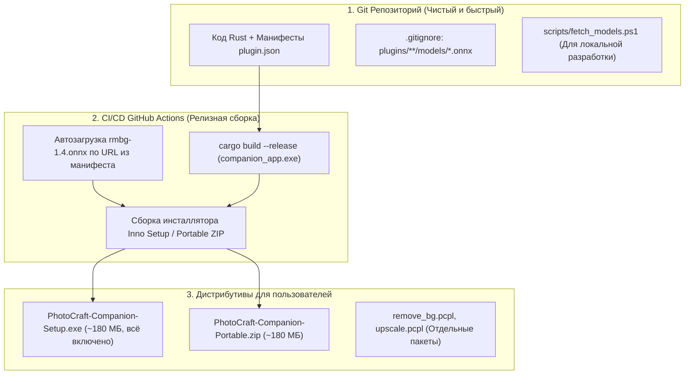
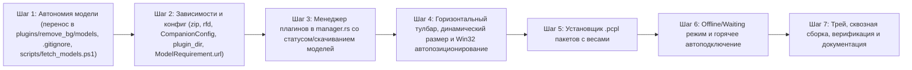

# План реализации: Плавающая панель инструментов, Менеджер плагинов, автономные плагины с моделями, CI/CD дистрибуция и система .pcpl

Настоящий документ определяет детальный технический план реализации плавающей панели инструментов (**Floating Toolstrip**), Менеджера плагинов (**Plugin Manager**) с вкладками настроек, **100% автономной архитектуры плагинов (Self-Contained Plugins)** с локальными моделями нейросетей, стратегии сборки релизов в CI/CD (легкий репозиторий + полновесный инсталлятор), системы установки пакетов **`.pcpl`**, режима ожидания редактора (**Offline / Waiting mode**) и полной интеграции с Windows/Win32 в соответствии со спецификацией [`docs/UI_AND_TOOLSTRIP_SPECIFICATION.md`](file:///d:/Projects/active/photocraft-plugins/docs/UI_AND_TOOLSTRIP_SPECIFICATION.md).

---

## 1. Сводка архитектурных решений

| Область                             | Текущая реализация                                                      | Целевое решение по спецификации                                                                                                                                                                                            |
| ----------------------------------- | ----------------------------------------------------------------------- | -------------------------------------------------------------------------------------------------------------------------------------------------------------------------------------------------------------------------- |
| **Автономия моделей нейросетей**    | `rmbg-1.4.onnx` загружается из временной папки `PhotoCraftData\models\` | **100% автономность:** модель хранится в `plugins/remove_bg/models/rmbg-1.4.onnx`, плагин полностью самодостаточен                                                                                                         |
| **CI/CD и Git-хранение моделей**    | Модели не разделены между Git и сборкой                                 | **«Лёгкий репозиторий, полный инсталлятор»:** в Git веса исключены (`.gitignore`), в манифесте прописан `url` + `sha256`, в CI/CD веса скачиваются в процессе сборки инсталлятора, для dev — скрипт и кнопка в UI          |
| **Пакетный формат `.pcpl`**         | Ручная раскладка папок                                                  | Единый ZIP-контейнер `.pcpl` (манифест + иконка + папка `models/` с весами), установка через диалог Windows                                                                                                                |
| **Ориентация Toolstrip**            | По умолчанию вертикальная (`is_vertical: true`)                         | По умолчанию **горизонтальная**, с кнопкой переключения в вертикальный столбик (`⇄` / `⇅`)                                                                                                                                 |
| **Геометрия Toolstrip**             | Фиксированные габариты                                                  | Динамический расчет: горизонт. `44 px` высота, ширина `(кнопок * 38) + 80 px`; верт. `46 px` ширина, высота `(кнопок * 38) + 40 px`                                                                                        |
| **Позиционирование Toolstrip**      | Статическое окно `eframe` по центру                                     | Автопозиционирование над холстом PhotoCraft справа (под меню параметров, слева от док-панелей) через Win32 API (`GetWindowRect`)                                                                                           |
| **Исполнение команд с кнопок**      | Клик по кнопке не отправляет команду на исполнение                      | Клик по кнопке отправляет асинхронную команду в сокет PhotoCraft или через `PluginRegistry` с отслеживанием результата                                                                                                     |
| **Компоновка Plugin Manager**       | Левый сайдбар с вкладками                                               | Горизонтальные вкладки сверху (`[ General ]`, `[ Plugins ]`, `[ Hotkeys ]`, `[ About ]`), контент во вложенной скругленной карточке (`#1e1e1e`), кнопки `[ Close ]` и `[ Save ]` справа внизу |
| **Offline / Запуск без PhotoCraft** | Приложение падает с ошибкой                                             | Графитовое окно ожидания, автоопрос сокета раз в 1.5 сек, кнопка настроек, автопереключение на панель при старте редактора                                                                                                 |
| **Конфигурация**                    | Только чтение `preferences.json`                                        | Полная поддержка `companion_config.json` (сохранение геометрии, темы, хоткеев, списка кнопок)                                                                                                                              |

---

## 2. Архитектура дистрибуции: «Лёгкий репозиторий — Полновесный инсталлятор»



### Структура дистрибутива на компьютере пользователя

```text
PhotoCraft Companion/
├── companion_app.exe             # Главный бинарник (трей, оверлей, менеджер)
├── onnxruntime.dll               # Движок локальных нейросетей (DirectML GPU)
├── DirectML.dll                  # Драйвер аппаратного ускорения DirectX 12
├── companion_config.json         # Файл настроек по умолчанию
├── assets/                       # Системные ресурсы
│   ├── icon-dark.svg             # Векторная темная иконка
│   └── icon_light.svg            # Векторная светлая иконка
└── plugins/                      # Папка встроенных плагинов
    ├── remove_bg/                # Плагин удаления фона («из коробки»)
    │   ├── plugin.json
    │   ├── icon.svg
    │   └── models/
    │       └── rmbg-1.4.onnx     # 168 МБ (уже внутри инсталлятора!)
    └── black_and_white/          # Встроенный No-Code макрос
        ├── plugin.json
        └── icon.svg
```

---

## 3. Детализация компонентов и предлагаемые изменения

### Компонент 1: Ядро контрактов и манифесты с источниками моделей

Файлы:

- `crates/core_contracts/src/plugin.rs` **[MODIFY]**
- `crates/core_contracts/src/registry.rs` **[MODIFY]**
- `crates/core_contracts/src/config.rs` **[NEW]**
- `crates/core_contracts/src/lib.rs` **[MODIFY]**
- `plugins/remove_bg/plugin.json` **[MODIFY]**

1. **Расширение `ModelRequirement`:**
   ```rust
   #[derive(Debug, Clone, Serialize, Deserialize)]
   pub struct ModelRequirement {
       pub name: String,
       pub required: bool,
       pub size_mb: Option<u64>,
       pub url: Option<String>,
       pub sha256: Option<String>,
   }
   ```
2. **Добавление `plugin_dir` в манифест:**
   При сканировании `scan_and_load` в манифест сохраняется абсолютный путь к папке плагина `plugin_dir`.
3. **Метод валидации моделей:**
   `manifest.is_model_present(plugin_dir, &model_name) -> bool`.
4. **Конфигурация `CompanionConfig`:**
   Хранение в `companion_config.json`: host, port, token, theme, language, is_vertical, window_pos, enabled_plugins, hotkey_overrides.

---

### Компонент 2: Физическая автономия `ai_engine`, перенос весов и скрипт загрузки

Файлы:

- `plugins/remove_bg/models/rmbg-1.4.onnx` **[NEW/MIGRATE]**
- `crates/ai_engine/src/lib.rs` **[MODIFY]**
- `.gitignore` **[MODIFY]**
- `scripts/fetch_models.ps1` **[NEW]**

1. **Локальный перенос:**
   Создание `plugins/remove_bg/models/` и копирование `rmbg-1.4.onnx` из `PhotoCraftData\models\`.
2. **Иерархия поиска в `AiEngine`:**
   - Приоритет 1: `plugin_dir.join("models").join(model_name)`
   - Приоритет 2: `PhotoCraftData/models/<model_name>` (fallback)
3. **Защита Git:**
   Правило в `.gitignore`: `plugins/**/models/*.onnx`.
4. **Вспомогательный скрипт разработки:**
   `scripts/fetch_models.ps1` — автоматическая проверка и скачивание отсутствующих моделей по URL из манифестов.

---

### Компонент 3: Плавающая панель инструментов (`crates/overlay_ui/src/toolstrip.rs`)

Файлы:

- `crates/overlay_ui/src/toolstrip.rs` **[MODIFY]**
- `crates/overlay_ui/src/win32_window.rs` **[NEW]**
- `crates/overlay_ui/src/lib.rs` **[MODIFY]**

1. **Ориентация:** По умолчанию горизонтальная (`is_vertical = false`), кнопка смены ориентации (`⇄` / `⇅`).
2. **Динамический размер:**
   - Горизонтальный: `height: 44.0 px`, `width: (active_count * 38.0) + 80.0 px`.
   - Вертикальный: `width: 46.0 px`, `height: (active_count * 38.0) + 40.0 px`.
   - Автообновление габаритов через `ViewportCommand::InnerSize`.
3. **Win32 автопозиционирование над холстом:**
   - `FindWindowW` / перебор окон PhotoCraft, считывание `GetWindowRect`.
   - Расчет: `Y = top + 75 px`, `X = right - width - 320 px` (над холстом справа от центра, слева от док-панелей).
4. **Исполнение команд:**
   - Клики по кнопкам транслируются в канал фонового исполнения задач `companion_app`.

---

### Компонент 4: Менеджер плагинов (`crates/overlay_ui/src/manager.rs`)

Файлы:

- `crates/overlay_ui/src/manager.rs` **[MODIFY]**

1. **Эталонная компоновка окна:**
   - Шапка: `⚙ PhotoCraft Companion Settings` с кнопкой `✕`.
   - Горизонтальные вкладки сверху: `[ General ]` `[ Plugins ]` `[ Hotkeys ]` `[ About ]`.
   - Контейнер контента: закругленная карточка `#1e1e1e` (скругление 8 px, тонкая рамка `#3e3e3e`).
   - Нижняя панель действий: кнопки `[ Close ]` и `[ Save ]` справа.
2. **Вкладка `[ General ]`:**
   - Language (English / Русский).
   - Theme (Dark, Light, System).
   - Connection: Host, Port (18492), Control Token, кнопка `[ Auto-Detect Token ]`.
3. **Вкладка `[ Plugins ]`:**
   - Кнопка `[ + Установить плагин (.pcpl) ]`.
   - Карточки плагинов с индикатором готовности весов:
     - `✓ Модель готова (168 МБ)`
     - При отсутствии модели: кнопка `[ ⬇ Скачать веса (168 МБ) ]` с загрузкой в `plugins/<id>/models/`.
     - Чекбокс активности, цветной бейдж типа, хоткей.
4. **Вкладка `[ Hotkeys ]`:**
   - Таблица действий и хоткеев с валидацией конфликтов.
5. **Вкладка `[ About ]`:**
   - Стек (Rust, DirectML GPU, egui), лицензия, документация.

---

### Компонент 5: Пакетный формат `.pcpl` и диалог установки

Файлы:

- `Cargo.toml` **[MODIFY]** (зависимости `zip = "2.2"`, `rfd = "0.15"`)
- `crates/core_contracts/src/package.rs` **[NEW]**
- `crates/core_contracts/src/registry.rs` **[MODIFY]**
- `crates/overlay_ui/src/manager.rs` **[MODIFY]**

1. **Распаковка `.pcpl`:**
   - Функция `install_pcpl(archive_path, plugins_dir)` распаковывает ZIP.
   - Валидирует `plugin.json`.
   - Распаковывает иконку и веса `models/` в `plugins/<id>/`.
   - Регистрирует плагин в `PluginRegistry`.
   - Немедленно обновляет список кнопок и пересчитывает ширину панели.
2. **Диалог проводника Windows:**
   - Интеграция `rfd::FileDialog` с фильтром `*.pcpl`.

---

### Компонент 6: Режим ожидания PhotoCraft (Offline / Waiting Mode)

Файлы:

- `crates/overlay_ui/src/offline_modal.rs` **[NEW]**
- `crates/overlay_ui/src/lib.rs` **[MODIFY]**
- `crates/companion_app/src/main.rs` **[MODIFY]**

1. **Работа при закрытом PhotoCraft:**
   - Приложение не завершает работу, а выводит графитовое окно ожидания:
     - _«PhotoCraft не обнаружен. Пожалуйста, запустите PhotoCraft, чтобы панель инструментов и плагины активировались.»_
     - Индикатор фоновой проверки сокета раз в 1.5 сек.
     - Кнопка `[ Открыть Менеджер плагинов ]`.
2. **Горячее переключение:**
   - При появлении PhotoCraft в сокете окно ожидания скрывается, плавающая панель появляется на холсте.

---

### Компонент 7: Системный трей и Win32 интеграция

Файлы:

- `crates/companion_app/src/main.rs` **[MODIFY]**
- `crates/companion_app/src/win32_theme.rs` **[MODIFY]**

1. Опрос `tray_icon::menu::MenuEvent` в UI-цикле (`PhotoCraft Toolbar`, `Plugins Manager`, `Exit Companion`).
2. Применение темного контекстного меню Win32 через `uxtheme::SetPreferredAppMode`.

---

## 4. Пошаговый план внедрения (Execution Steps)



### Шаг 1: Физическая автономия модели, .gitignore и скрипт моделей

- Создать `plugins/remove_bg/models/`.
- Скопировать `rmbg-1.4.onnx` из `PhotoCraftData\models\` в `plugins/remove_bg/models/rmbg-1.4.onnx`.
- Добавить `plugins/**/models/*.onnx` в `.gitignore`.
- Создать `scripts/fetch_models.ps1`.
- Обновить `AiEngine::get_model_path()` для приоритетного использования локальной папки плагина.

### Шаг 2: Модель конфигурации и зависимости

- Добавить `zip` и `rfd` в `Cargo.toml`.
- Добавить `url` и `sha256` в `ModelRequirement`.
- Реализовать `CompanionConfig` в `crates/core_contracts/src/config.rs`.
- Добавить поле `plugin_dir` в `PluginManifest` и `PluginContext`.

### Шаг 3: Обновление Менеджера плагинов с горизонтальными вкладками

- Горизонтальные верхние вкладки: `[ General ]`, `[ Plugins ]`, `[ Hotkeys ]`, `[ About ]`.
- Карточка контента `#1e1e1e` со скруглением 8 px.
- Кнопки `[ Close ]` и `[ Save ]` справа внизу.
- Отображение статуса моделей и кнопка загрузки при их отсутствии.

### Шаг 4: Обновление плавающей панели инструментов (Toolstrip)

- Горизонтальная ориентация по умолчанию, кнопка `⇄` / `⇅`.
- Динамический размер окна (высота 44 px, автоширина по числу кнопок).
- Win32 автопозиционирование над холстом PhotoCraft.
- Передача кликов кнопок в исполнитель команд.

### Шаг 5: Установщик пакетов `.pcpl`

- Реализация `package::install_pcpl` (распаковка манифеста, иконки и весов в `plugins/<id>/`).
- Подключение диалога выбора файла через `rfd::FileDialog`.

### Шаг 6: Реализация режима ожидания (Offline / Waiting Mode)

- Реализация компонента `OfflineModal`.
- Устранение падения при отсутствии PhotoCraft — переход в фоновый опрос 1.5 сек.
- Автоматическая активация панели при запуске редактора.

### Шаг 7: Системный трей, сквозная сборка, верификация и документация

- Интеграция событий меню трея.
- Проверка компиляции `cargo check --workspace` и запуск тестов.
- Синхронизация `docs/CHECKLIST.md`, `docs/BUGS_AND_ISSUES.md`, `docs/CHRONICLE.md` и `docs/CHRONICLE.en.md`.

---

## 5. План верификации

### Автоматические тесты

```powershell
cargo check --workspace --all-targets
cargo test --workspace
cargo build --package companion_app
```

### Ручная верификация

1. **Проверка автономности модели:** Убедиться, что плагин `remove_bg` успешно загружает веса из `plugins/remove_bg/models/rmbg-1.4.onnx` и выполняет инференс на GPU.
2. **Проверка Offline режима:** Запуск без PhotoCraft -> появление окна ожидания -> нажатие «Открыть Менеджер» -> открытие настроек.
3. **Проверка горячего подключения:** Запуск PhotoCraft -> закрытие окна ожидания -> появление тулбара над холстом справа.
4. **Проверка динамического размера:** Переключение ориентации тулбара (`⇄` / `⇅`) и проверка точности размеров.
5. **Проверка установки `.pcpl`:** Создание тестового `.pcpl` с моделью -> установка через диалог Менеджера -> проверка появления кнопки на панели.
6. **Проверка сохранения настроек:** Смена темы/языка -> нажатие `[ Save ]` -> проверка записи в `companion_config.json`.
