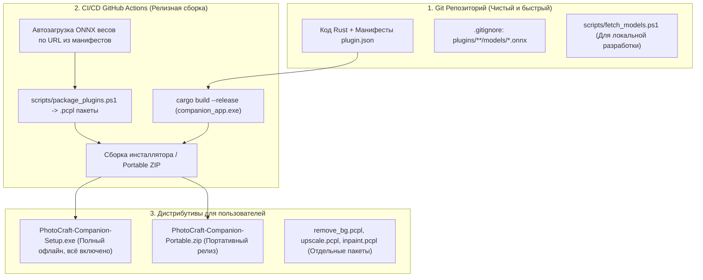

# Генеральный план развития: Универсальное ИИ-ядро (Zero-Core Architecture), 4 Парадигмы CV, Декларативные плагины и CI/CD дистрибуция .pcpl

**Статус документа:** Активный генеральный план проекта (Единый источник истины)  
**Дата актуализации:** 12 октября 2026  
**Основание:** Слияние архитектурной концепции 4 Парадигм Компьютерного Зрения (`docs/UNIVERSAL_AI_CORE_ARCHITECTURE.md`) и регламента инфраструктуры/дистрибуции (`docs/PLAN.md`, `docs/UI_AND_TOOLSTRIP_SPECIFICATION.md`).

---

## 1. Стратегическая цель проекта

Создать **полностью универсальное, замороженное ядро `AiEngine` и рантайм `GenericAiPlugin`**, способное исполнять **любые современные и будущие нейросети компьютерного зрения** исключительно на основе текстового манифеста `plugin.json` и пакетов `.pcpl` **без модификации и перекомпиляции исходного кода Rust**.

Система объединяет:
1. Кроссплатформенную плавающую панель инструментов (**Floating Toolstrip**) и графический **Менеджер плагинов**;
2. Автономность плагинов (**Self-Contained Plugins**) и модель распространения **«Лёгкий репозиторий — Полновесный инсталлятор»**;
3. Универсальный математический рантайм **4 Парадигм Компьютерного Зрения** с честным нативным 1:1 тайлингом без потери резкости;
4. Единый пакетный менеджер **`.pcpl`** (установка моделей, иконок и логики в один клик).

---

## 2. Статус базового фундамента (Реализовано на 100% ✅)

Следующие модули старого плана полностью реализованы, отлажены и покрыты интеграционными тестами в кодовой базе:

- [x] **Плавающая панель инструментов (Toolstrip):** Two-Tier компоновка на `egui/eframe`, авто-ориентация (горизонтальная/вертикальная), Win32 автопозиционирование над холстом PhotoCraft справа от центра, адаптивный ресайз без обрезания кнопок (BUG-016, BUG-022, BUG-025).
- [x] **HUD Toast / Mini-бейдж выполнения:** всплывающий статус под панелью (`Idle`, `Running`, `Success`, `Error`) с таймером и блокировкой повторных кликов (BUG-032).
- [x] **Графический Менеджер плагинов:** вкладки `[ General ]`, `[ Plugins ]`, `[ Hotkeys ]`, `[ About ]`, тумблеры активности, интерактивный захват сочетаний клавиш (BUG-014), закрепленные кнопки `[ Close ]` и `[ Save ]` (BUG-011).
- [x] **Режим ожидания (Offline / Waiting Mode):** графитовое окно ожидания при закрытом PhotoCraft с автоопросом сокета 18492 раз в 1.5 секунды и горячим бесшовным показом панели при старте редактора.
- [x] **Интеграция с системным треем:** мгновенный отклик меню трея без задержек (BUG-018, BUG-024), синхронизация смены светлой/тёмной темы и иконок приложения (BUG-008, BUG-009).
- [x] **Пакетная система `.pcpl`:** распаковка ZIP-контейнеров с манифестами, иконками и локальными весами через диалог Windows `rfd` и `zip`.
- [x] **Адаптивный execution provider:** автоматический безопасный откат DirectML $\to$ CPU при сбоях матричных операций в сложных моделях (BUG-034).

---

## 3. Архитектура универсального ИИ-ядра: 4 Парадигмы 2D CV

99% всех моделей компьютерного зрения для растровой графики сводятся к **четырем чистым математическим паттернам**:

```
                       ┌────────────────────────┐
                       │   Входное изображение   │
                       └───────────┬────────────┘
                                   │
         ┌─────────────────────────┼─────────────────────────┬───────────────────────┐
         ▼                         ▼                         ▼                       ▼
 ┌───────────────┐        ┌─────────────────┐       ┌─────────────────┐     ┌─────────────────┐
 │1. Image-to-Img│        │2. Super-Resolut.│       │  3. Inpainting  │     │ 4. Segmentation │
 │  RGB -> RGB   │        │ RGB -> N x RGB  │       │RGB+Mask -> RGB  │     │  RGB -> Alpha   │
 └───────┬───────┘        └────────┬────────┘       └────────┬────────┘     └────────┬────────┘
         │                         │                         │                       │
         ▼                         ▼                         ▼                       ▼
   Денойз, Деблюр,          2x/4x Апскейл             Бесшовное               Удаление фона,
 Реставрация старых        с расширением             удаление объектов       выделение объектов
  фото, Колоризация,           холста                в нативном 1:1              (RMBG, SAM)
     Стилизация                                      масштабе тайлами
```

### Парадигма 1: `image_to_image` (Преобразование 1:1)
* **Вход:** RGB/RGBA изображение размера $W \times H$.
* **Выход:** RGB/RGBA изображение размера $W \times H$.
* **Примеры моделей:** NAFNet (деблюр/денойз), Restormer (реставрация), CodeFormer/GFPGAN (восстановление лиц), DDColor (раскраска ч/б фото), AnimeGAN (стилизация).
* **Алгоритм ядра:** Тайлинг 1:1 с нахлёстом (`tile_pad`) и плавной сшивкой без изменения исходного разрешения.

### Парадигма 2: `super_resolution` (Увеличение сетки $N\times$)
* **Вход:** RGB/RGBA изображение размера $W \times H$.
* **Выход:** RGB/RGBA изображение размера $(W \cdot N) \times (H \cdot N)$.
* **Примеры моделей:** Real-ESRGAN, Compact, SwinIR, HAT, UltraSharp ($2\times, 4\times$).
* **Алгоритм ядра:** Тайлинг с масштабным коэффициентом $N$ и последующее расширение холста (`image.revealAll`).

### Парадигма 3: `inpainting` (Заливка по маске без потери резкости)
* **Вход:** RGB/RGBA изображение размера $W \times H$ + одноканальная маска $W \times H$ (255 — удалить, 0 — оставить).
* **Выход:** RGB/RGBA изображение размера $W \times H$, где маскированные пиксели правдоподобно заменены окружающим контекстом.
* **Примеры моделей:** LaMa, MAT (Mask-Aware Transformer), BrushNet.
* **Алгоритм ядра:** **Честный тайлинг в нативном масштабе 1:1!** Нарезка маскированной зоны на блоки $512 \times 512$ с контекстным окном вокруг выделения, заливка нативной текстурой без сжатия в мыло и сшивка по маске.

### Парадигма 4: `segmentation` (Извлечение маски)
* **Вход:** RGB/RGBA изображение размера $W \times H$.
* **Выход:** Одноканальная маска (Alpha/Luma) размера $W \times H$.
* **Примеры моделей:** RMBG-1.4/2.0, BiRefNet, Segment Anything (SAM).
* **Алгоритм ядра:** Прогон через модель и применение полученной альфа-маски к исходному слою (создание вырезки / Cutout).

---

## 4. Декларативный манифест плагина (`plugin.json`)

Для добавления любой новой модели автор плагина **НЕ пишет код на Rust**. Достаточно положить файл `.onnx` и описать манифест `plugin.json`:

```json
{
  "id": "author.photo_restorer",
  "name": "AI Old Photo Restorer",
  "version": "1.0.0",
  "plugin_type": "native_ai",
  "default_hotkey": "Ctrl+Shift+R",
  "icon": "brush",
  "input": "active_layer",
  "output_mode": "in_place",
  "post_commands": [],
  "ai": {
    "task": "image_to_image",
    "tile_size": 512,
    "tile_pad": 32,
    "normalize": "zero_to_one"
  },
  "models": [
    {
      "name": "nafnet_restoration.onnx",
      "required": true,
      "size_mb": 68,
      "url": "https://huggingface.co/.../model.onnx"
    }
  ]
}
```

### Параметры блока `ai`:
1. `task` (строго один из 4): `"image_to_image"`, `"super_resolution"`, `"inpainting"`, `"segmentation_mask"`;
2. `scale` (опционально для super_resolution): целое число ($2, 4$);
3. `tile_size` (опционально): размер рабочего окна ($512$ или $1024$ px);
4. `tile_pad` (опционально): нахлёст для бесшовной сшивки ($16$ или $32$ px);
5. `normalize` (опционально):
   * `"zero_to_one"`: деление на 255.0 ($[0.0, 1.0]$);
   * `"centered"`: вычитание 0.5 и деление на 1.0 (для RMBG);
   * `"raw_255"`: передача целых значений $[0.0, 255.0]$ (для LaMa).

---

## 5. Архитектура дистрибуции: «Лёгкий репозиторий — Полновесный инсталлятор»

Модели нейросетей имеют большой объем (от 70 до 250 МБ каждая). Сохраняется строгий регламент хранения и распространения:



### Правила целостности моделей:
1. В Git отслеживаются только исходный код, манифесты и векторные иконки. Бинарные `.onnx` исключены через `.gitignore`.
2. В секции `models` манифеста каждого плагина обязательно указываются `url`, `size_mb` и имя файла.
3. В Менеджере плагинов при отсутствии модели отображается кнопка `[ ⬇ Скачать веса ]` со скачиванием напрямую в папку плагина.
4. Скрипт `scripts/package_plugins.ps1` упаковывает самодостаточные `.pcpl` архивы с уже вложенными весами для установки без интернета.

---

## 6. План реализации универсального ядра (Action Items)

### Шаг 1: Расширение структур в `core_contracts`
- [ ] Добавить в `AiTask` вариант `ImageToImage` (наряду с `SuperResolution`, `Inpainting`, `SegmentationMask`).
- [ ] Добавить в `AiPipelineConfig` поля `tile_size: Option<u32>`, `tile_pad: Option<u32>`, `normalize: Option<String>`.
- [ ] Покрыть юнит-тестами сериализацию и парсинг манифестов всех 4 парадигм.

### Шаг 2: Реализация единого раннера в `ai_engine`
- [ ] Написать универсальный модуль тайлинга `run_tiled_inference` с нахлёстом и гладкой сшивкой швов.
- [ ] Реализовать адаптивный инференс 4 парадигм:
  - `execute_image_to_image`
  - `execute_super_resolution`
  - `execute_inpainting` (нативный 1:1 тайлинг вокруг выделения без размытия)
  - `execute_segmentation`
- [ ] Создать структуру `GenericAiPlugin`, реализующую трейт `Plugin`, которая связывает входные данные (`input`), сессию ONNX, универсальный инференс, наложение (`output_mode`) и цепочку `post_commands`.
- [ ] Удалить устаревший специфичный `RemoveBgPlugin` из `ai_engine`.

### Шаг 3: Подключение и проверка в `companion_app`
- [ ] Подключить `GenericAiPlugin` в фабрику `with_ai_factory` в `main.rs`.
- [ ] Проверить автосканирование и динамический запуск плагинов `remove_bg`, `upscale`, `inpaint`.
- [ ] Убедиться в полном отсутствии хардкода под названия моделей.

### Шаг 4: Верификация тестами и защита ресурсов
- [ ] Компиляция и тесты strictly с защитой ресурсов: `cargo test --workspace -j 1`.
- [ ] Проверка линтера локализации `i18n_lint_test`.
- [ ] Синхронизация `docs/CHECKLIST.md`, `docs/BUGS_AND_ISSUES.md`, `docs/CHRONICLE.md` и `docs/CHRONICLE.en.md`.
