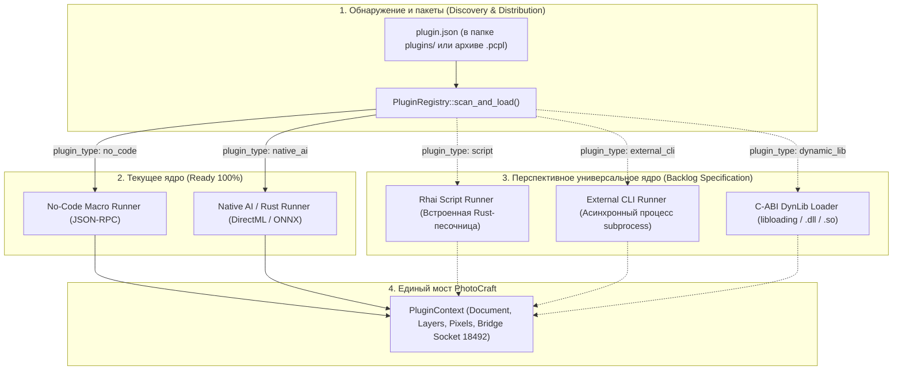

# Спецификация универсального ядра плагинов (Universal Plugin Core Specification)

Настоящий документ определяет детальную техническую спецификацию трёх перспективных форматов плагинов для расширения системы PhotoCraft Companion: **встроенных безопасных скриптов (Rhai)**, **внешних консольных процессов (CLI)** и **динамически загружаемых библиотек (C-ABI DynLib / `.dll`)**.

Документ дополняет базовую спецификацию [`docs/UI_AND_TOOLSTRIP_SPECIFICATION.md`](file:///d:/Projects/active/photocraft-plugins/docs/UI_AND_TOOLSTRIP_SPECIFICATION.md) и генеральный регламент [`docs/AGENTS_MASTER_GUIDE.md`](file:///d:/Projects/active/photocraft-plugins/docs/AGENTS_MASTER_GUIDE.md).

---

## 1. Архитектурная матрица форматов плагинов



---

## 2. Формат 1: Встроенный скриптовый движок Rhai (`PluginType::Script`)

### 2.1. Концепция и выбор технологии
Для легковесной автоматизации и скриптинга без необходимости компиляции выбран язык **Rhai** (v1.19+):
- **100% безопасный Rust:** не имеет C-зависимостей, не требует внешней сборки (в отличие от Lua/QuickJS), полностью кроссплатформенный (Windows, macOS, Linux, BSD).
- **Песочница по умолчанию:** в скриптах Rhai по умолчанию нет неконтролируемого доступа к файловой системе или сети; плагин имеет доступ только к тем объектам и методам, которые хост явно предоставил в `Scope` и `Engine`.
- **Эргономичный синтаксис:** похож на JavaScript / Rust, прост в освоении художниками и техническими дизайнерами.

### 2.2. Манифест скриптового плагина (`plugin.json`)
```json
{
  "id": "script.photocraft.invert_and_blend",
  "name": "Invert & Blend Helper",
  "version": "1.0.0",
  "description": "Скриптовое дублирование активного слоя с инверсией и полупрозрачностью.",
  "author": "kobaltGIT",
  "plugin_type": "script",
  "entrypoint": "main.rhai",
  "default_hotkey": "Ctrl+Shift+I",
  "icon": "adjust"
}
```

### 2.3. Пример файла скрипта (`main.rhai`)
```rhai
// Чтение метаданных документа PhotoCraft
let doc = get_document();
print("Обработка документа: " + doc.name + " (" + doc.width + "x" + doc.height + ")");

// Вызов нативных команд редактора из 851 доступных в PhotoCraft
execute_command("layer.duplicate", #{});
execute_command("filter.invert", #{});
execute_command("layer.setOpacity", #{ "opacity": 0.65 });

// Возврат статусного сообщения пользователю
return "Слой успешно инвертирован и наложен с прозрачностью 65%!";
```

### 2.4. Хост-биндинги в Rust (`RhaiScriptRunner`)
1. Создание изолированного экземпляра `rhai::Engine`.
2. Регистрация кастомного типа `DocumentInfo`:
   - Геттеры: `doc.name`, `doc.width`, `doc.height`, `doc.active_layer`.
3. Регистрация хост-функций:
   - `get_document() -> Dynamic`
   - `execute_command(cmd: &str, params: Map) -> Dynamic`
   - `rename_layer(layer_id: INT, new_name: &str) -> Dynamic`
   - `log_info(msg: &str)`
4. Вызов `engine.eval_file_with_scope::<Dynamic>(&mut scope, script_path)`.
5. Преобразование результата выполнения в `core_contracts::PluginResult`.

---

## 3. Формат 2: Внешние консольные утилиты (`PluginType::ExternalCli`)

### 3.1. Концепция
Позволяет пользователям и разработчикам подключать любые готовые консольные утилиты (`.exe`, `.bat`, `.cmd`, `.py`, `.sh`), такие как ImageMagick (`magick.exe`), OptiPNG, ffmpeg, кастомные Python-пайплайны со Stable Diffusion или Go/C++ утилиты.

### 3.2. Манифест CLI-плагина (`plugin.json`)
```json
{
  "id": "cli.photocraft.optimize_png",
  "name": "OptiPNG Compression",
  "version": "1.0.0",
  "description": "Оптимизация активного растра через внешнюю утилиту OptiPNG.",
  "author": "kobaltGIT",
  "plugin_type": "external_cli",
  "entrypoint": "bin/optipng.exe",
  "cli_args": [
    "-o5",
    "{input_file}"
  ],
  "io_mode": "temp_file_in_place",
  "default_hotkey": "Ctrl+Alt+O",
  "icon": "film"
}
```

### 3.3. Режимы ввода-вывода (`CliIoMode`)
1. **`JsonArgs`:**
   - Параметры документа и слоя передаются в утилиту в виде аргументов командной строки (`--doc-width 1920 --doc-height 1080 --doc-name "Art"`).
2. **`StdinStdout`:**
   - Пиксели активного слоя в формате PNG/RGBA передаются в `stdin` дочернего процесса.
   - Результат считывается из `stdout` и вставляется обратно на холст через `BridgeOperations::paste_image_in_place`.
3. **`TempFileInPlace`:**
   - Компаньон сохраняет растр активного слоя во временный файл во временной папке проекта (`scratch/temp_layer.png`).
   - Путь подставляется в шаблон `{input_file}`.
   - После завершения процесса компаньон считывает обновленный файл и вставляет его обратно в активный документ.

### 3.4. Исполнение в Rust (`CliProcessRunner`)
- Использование `tokio::process::Command`.
- Подстановка шаблонов: `{doc_name}`, `{width}`, `{height}`, `{active_layer_id}`, `{input_file}`, `{output_file}`.
- Защита от зависания процесса через `tokio::time::timeout` (по умолчанию таймаут 60 секунд).
- Сбор `stdout` и `stderr`, форматирование кода завершения процесса (Exit Status Code 0 — успех, иначе возврат `CompanionError::Plugin`).

---

## 4. Формат 3: Динамически загружаемые библиотеки (`PluginType::DynamicLib`)

### 4.1. Концепция
Для разработчиков высокопроизводительных плагинов на C, C++, Rust, Zig, Go или C# (AOT), которым необходима максимальная скорость вычислений без ограничений скриптов и без необходимости пересборки основного бинарника `companion_app.exe`.
Плагин компилируется в динамическую библиотеку (`.dll` на Windows, `.so` на Linux, `.dylib` на macOS) и распространяется в виде файла или архива `.pcpl`.

### 4.2. Стабильный C-ABI контракт v1 (`photocraft_c_abi.h`)

Чтобы избежать проблем с нестабильностью vtable Rust при разных версиях компилятора, интерфейс между хостом и библиотекой строится строго по стандарту **C-ABI**:

```c
#ifndef PHOTOCRAFT_PLUGIN_ABI_H
#define PHOTOCRAFT_PLUGIN_ABI_H

#include <stdint.h>
#include <stddef.h>

#define PHOTOCRAFT_API_VERSION 1

// Контекст вызова плагина
typedef struct {
    uint32_t api_version;
    uint32_t doc_width;
    uint32_t doc_height;
    uint64_t active_layer_id;
    const char* doc_name_utf8;
    const char* plugin_dir_utf8;
    
    // Callback хоста для вызова 851 команды PhotoCraft
    int32_t (*execute_command)(
        const char* command_utf8,
        const char* params_json_utf8,
        char* out_response_json,
        size_t out_response_size
    );
} PhotoCraftContextC;

// Экспортируемая функция плагина
// Возвращает: 0 = УСПЕХ, ненулевое значение = КОД ОШИБКИ
#if defined(_WIN32)
  #define PHOTOCRAFT_EXPORT __declspec(dllexport)
#else
  #define PHOTOCRAFT_EXPORT __attribute__((visibility("default")))
#endif

PHOTOCRAFT_EXPORT int32_t photocraft_plugin_execute(
    const PhotoCraftContextC* ctx,
    char* out_message_buf,
    size_t out_message_size
);

#endif // PHOTOCRAFT_PLUGIN_ABI_H
```

### 4.3. Реализация хост-загрузчика на Rust (`DynLibRunner`)
- Загрузка библиотеки через `libloading::Library::new(dll_path)`.
- Поиск символа:
  ```rust
  let execute_fn: Symbol<unsafe extern "C" fn(*const PhotoCraftContextC, *mut c_char, usize) -> i32> = 
      lib.get(b"photocraft_plugin_execute\0")?;
  ```
- Формирование структуры `PhotoCraftContextC` с замыканием обратного вызова `execute_command`.
- Вызов внешней функции с обработкой SEH / паники и буферизацией результирующего сообщения.

---

## 5. Интеграция с пакетным менеджером `.pcpl`

Все 5 форматов плагинов (No-Code, Native AI, Rhai Script, External CLI, C-ABI DynLib) используют единый унифицированный формат пакета **`.pcpl`** (PhotoCraft Plugin Package):

```text
my_plugin.pcpl (ZIP-архив)
├── plugin.json              # Манифест с типом плагина (no_code / native_ai / script / external_cli / dynamic_lib)
├── icon.svg                 # Векторная иконка для плавающей панели инструментов
├── main.rhai                # (для script плагинов)
├── tool.exe                 # (для external_cli плагинов)
├── plugin.dll               # (для dynamic_lib плагинов)
└── models/                  # (опционально: локальные веса ONNX для нейросетевых плагинов)
    └── my_model.onnx
```

При установке через Менеджер плагинов ([crates/overlay_ui/src/manager.rs](file:///d:/Projects/active/photocraft-plugins/crates/overlay_ui/src/manager.rs#L354-L370)) распаковщик `install_pcpl`:
1. Автоматически извлекает манифест, иконки, исполняемые файлы и веса моделей.
2. Инициализирует соответствующий раннер согласно полю `plugin_type`.
3. Добавляет кнопку на плавающую панель инструментов с мгновенным динамическим ресайзом.
